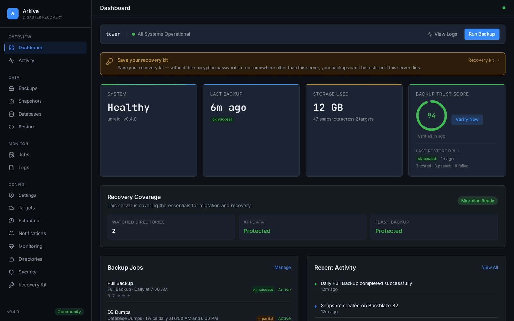
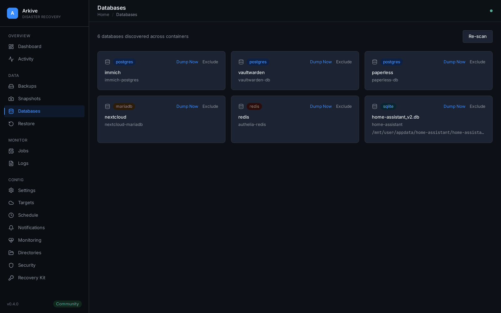
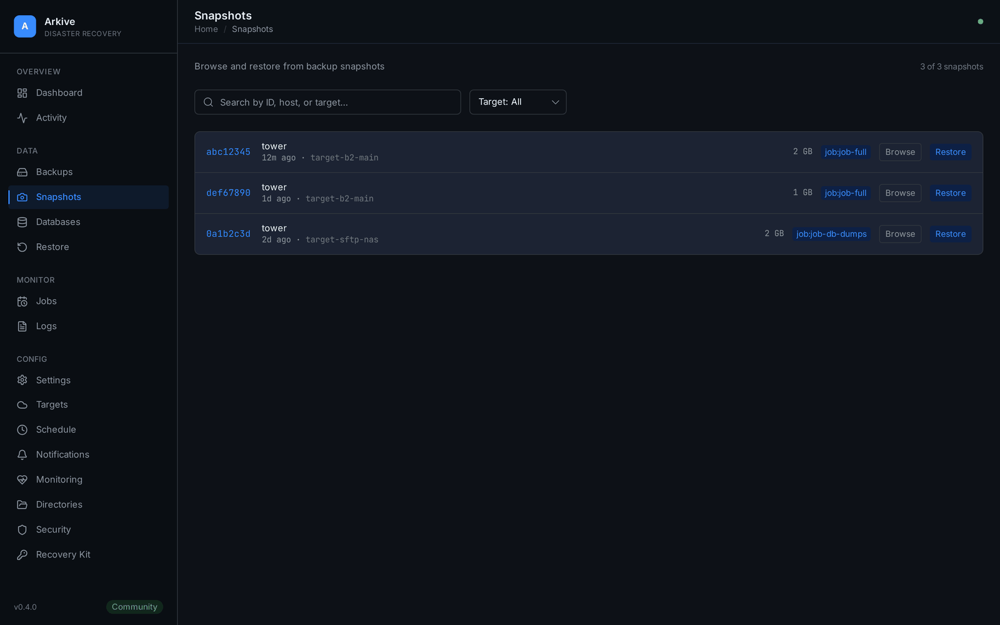

<h1 align="center">Arkive</h1>

<p align="center">
  <strong>Open-source backup and disaster recovery for Unraid servers.</strong><br />
  Discovers your Docker apps and their databases, takes consistent database dumps,
  encrypts every snapshot with restic, and proves the backups restore.
</p>

<p align="center">
  <a href="https://github.com/islamdiaa/Arkive/actions/workflows/build.yml"></a>
  <a href="https://github.com/islamdiaa/Arkive/releases/latest"></a>
  <a href="https://hub.docker.com/r/islamdiaa/arkive"></a>
  <a href="LICENSE"></a>
  
  
</p>

<p align="center">
  <picture>
    <source media="(prefers-color-scheme: light)" srcset="docs/images/dashboard-light.png" />
    
  </picture>
</p>

---

## Why Arkive

Copying `appdata` while databases are running produces backups that may not restore. Arkive finds the databases behind your containers, dumps each one with its native tool, and snapshots the dumps together with your files. Then it keeps checking that backups are still happening and that they actually restore. It doesn't assume a scheduled job worked.

Arkive is under active development. Backup, snapshot, restore, cloud targets and verification are implemented and covered by unit, integration and end-to-end tests.

## Features

**Backup**
- **Automatic discovery.** Finds database containers by image, scans app bind mounts for SQLite files, and ships profiles for common apps (Immich, Paperless-ngx, Vaultwarden, Plex, Authelia, Sonarr/Radarr, …).
- **Application-consistent dumps.** PostgreSQL (every database in the cluster, plus roles), MariaDB/MySQL, MongoDB, SQLite and Redis. Truncated or corrupt dumps are detected and never replace the last good one.
- **Encrypted, deduplicated snapshots.** Powered by [restic](https://restic.net/). Each snapshot holds the database dumps, the Unraid flash config and your watched directories, so any one snapshot is a complete restore point.
- **Storage targets.** Local disk, Backblaze B2, S3-compatible storage (AWS, MinIO, …), Wasabi, SFTP, Google Drive and Dropbox, via [rclone](https://rclone.org/). Use several at once.
- **Schedules and retention.** Cron schedules (no system cron needed), keep-daily/weekly/monthly retention, and weekly pruning. A job that fires while another backup runs waits for it.

**Knowing it works**
- **No silent successes.** A run that misses anything (a database, a path, a target, unreadable files) is reported as `partial`, with the reason.
- **Overdue-backup watchdog.** If a job hasn't produced a good backup within its schedule window, the dashboard turns red and you get an alert.
- **Heartbeat.** Point Arkive at an Uptime Kuma push monitor or a healthchecks.io check. Arkive pings it only while every job is healthy, so you're also alerted when Arkive itself is down.
- **Restore drills.** Every week, Arkive restores recent database dumps from the latest snapshot and loads each into a temporary, network-isolated copy of its own database image.
- **Repository checks.** A weekly `restic check`, a test restore of a random file, and a trust score on the dashboard.
- **Notifications** through Apprise: Discord, Slack, ntfy, Telegram, email, Gotify, Pushover, Uptime Kuma and webhooks.

**Restore**
- **Recovery kit.** A one-time export of the encryption password, every repository location and step-by-step restore instructions, so your backups stay usable if the server is lost.
- **Snapshot browser and granular restore** of individual files and dumps.
- **Restore plan.** A downloadable PDF tailored to your setup.

**Interface**
- A dashboard with live backup progress, health and storage use, in light and dark themes.
- A six-step setup wizard: encryption password, container discovery, storage, schedules, directories, done.
- A REST API with OpenAPI docs at `/docs`, and a CLI.

<table>
  <tr>
    <td width="50%">
      <picture>
        <source media="(prefers-color-scheme: light)" srcset="docs/images/databases-light.png" />
        
      </picture>
      <p align="center"><sub>Discovered databases, each dumped with its native tool</sub></p>
    </td>
    <td width="50%">
      <picture>
        <source media="(prefers-color-scheme: light)" srcset="docs/images/snapshots-light.png" />
        
      </picture>
      <p align="center"><sub>Snapshots across targets, browsable and restorable</sub></p>
    </td>
  </tr>
</table>

<sub>Screenshots use the built-in demo data: open any page with <code>?demo=true</code>.</sub>

---

## Quick start

### Unraid

Add the template from `https://raw.githubusercontent.com/islamdiaa/Arkive/main/unraid-template.xml` (or install from Community Applications if it's listed there). The template mounts app data read-only and keeps Arkive's own state in `/mnt/user/appdata/arkive`.

### Docker Compose

```yaml
services:
  arkive:
    image: islamdiaa/arkive:latest
    container_name: arkive
    # On Unraid, run as root so flash backup and app-owned SQLite files are readable.
    user: "0:0"
    ports:
      - "8200:8200"
    volumes:
      - /var/run/docker.sock:/var/run/docker.sock:ro
      - /mnt/user/appdata/arkive:/config
      - /mnt/user/appdata/arkive/cache:/cache
      - /mnt/user/appdata:/mnt/user/appdata:ro
      - /boot/config:/boot-config:ro
      # Destination for a local storage target (must be a host path)
      - /mnt/user/backups:/mnt/user/backups
    environment:
      - TZ=America/New_York
    restart: unless-stopped
```

### Docker run

```bash
docker run -d --name arkive --restart unless-stopped --user 0:0 \
  -p 8200:8200 -e TZ=America/New_York \
  -v /var/run/docker.sock:/var/run/docker.sock:ro \
  -v /mnt/user/appdata/arkive:/config \
  -v /mnt/user/appdata/arkive/cache:/cache \
  -v /mnt/user/appdata:/mnt/user/appdata:ro \
  -v /boot/config:/boot-config:ro \
  -v /mnt/user/backups:/mnt/user/backups \
  islamdiaa/arkive:latest
```

### First boot

Open `http://your-server:8200` and follow the setup wizard. It asks for an encryption password, discovers your containers, sets up a storage target and schedules, and lets you add extra directories.

Afterwards:
1. **Save the recovery kit** (Settings → Recovery kit) somewhere other than the server. Without the encryption password, no snapshot can be opened.
2. **Add a notification channel** (Settings → Notifications) so failures reach you.
3. **Add an off-site target.** A local target on the same array doesn't protect against losing the server.

The browser may then ask for the admin API key once, to create a session.

### Upgrading

Pull the new image and recreate the container with the same `/config` volume (`docker compose pull && docker compose up -d`). Database migrations run automatically on start.

---

## How it works

```
 DISCOVER   Docker socket -> containers, their databases, app profiles
 DUMP       pg_dump / mysqldump / mongodump / SQLite .backup / redis BGSAVE
 SNAPSHOT   restic: encrypted, deduplicated (dumps + flash + watched dirs)
 UPLOAD     each storage target in turn (local, or rclone for cloud/SFTP)
 RETAIN     keep-daily / weekly / monthly, weekly prune
 VERIFY     overdue watchdog, weekly restic check, restore drills
 NOTIFY     Apprise channels, plus an optional heartbeat URL
```

## Supported databases

| Engine | How it is dumped | Example apps |
|--------|------------------|--------------|
| PostgreSQL | `pg_dump` for every database in the cluster, plus `pg_dumpall --globals-only` (roles) | Immich, Nextcloud, Gitea, Authentik |
| MariaDB / MySQL | `mysqldump --single-transaction` | WordPress, BookStack, Firefly III |
| MongoDB | `mongodump` | UniFi Controller, Rocket.Chat |
| SQLite | online `.backup`, then `PRAGMA integrity_check` | Vaultwarden, Home Assistant, Plex |
| Redis | `BGSAVE` + `dump.rdb` | Authelia, Outline |

SQL dumps must end with the tool's completion trailer, or they count as failed. They are stored uncompressed by default (**Settings → Dump compression**). restic compresses the repository, and an uncompressed dump deduplicates against the previous one, so a large database adds only its changes to each snapshot. Choose gzip if the local dump folder's size matters more. `arkive-dumps-manifest.json`, included in every snapshot, records which dump file belongs to which container and database.

---

## Configuration

### Environment variables

| Variable | Default | Purpose |
|----------|---------|---------|
| `TZ` | `UTC` | Time zone for schedules and logs |
| `ARKIVE_CONFIG_DIR` | `/config` | Database, logs, dumps and restores |
| `ARKIVE_LOG_LEVEL` | `INFO` | Log level (logs are JSON) |
| `ARKIVE_TRUSTED_PROXIES` | (none) | Comma-separated IPs/CIDRs of reverse proxies whose `X-Forwarded-For` is trusted |
| `ARKIVE_CORS_ORIGINS` | localhost dev origins | Comma-separated extra origins allowed to call the API |
| `ARKIVE_ALLOW_NEW_KEYFILE` | `0` | Start even if `/config/.keyfile` is missing or doesn't match the database (see below) |
| `ARKIVE_DEV_MODE` | `0` | Development only: skip the Docker socket and binary checks |

### Volumes

| Mount | Purpose | Mode |
|-------|---------|------|
| `/var/run/docker.sock` | Container discovery and dumps | read-only |
| `/config` | Arkive's database, logs, dumps, restores | read-write, required |
| `/cache` | restic metadata cache | read-write, recommended |
| A local target path, e.g. `/mnt/user/backups` | Destination of a local storage target | read-write |
| `/mnt/user/appdata` (and anything else to protect) | Data to back up | read-only |
| `/boot/config` → `/boot-config` | Unraid flash config backup | read-only |

Arkive only writes to `/config`, `/cache` and local target paths. Restores always land in `/config/restores`, and you copy the files into place from there, so the data you protect can stay mounted read-only.

A local target must be a path mapped to the host. Arkive refuses targets inside the container's own filesystem or an anonymous volume, because those are deleted when the container is re-created.

On Unraid, run as `root`. The flash config and some app-owned SQLite files aren't readable by other users, and backups will be `partial` without root.

### Encryption key and recovery kit

Secrets in Arkive's database (the restic password, storage credentials) are encrypted with `/config/.keyfile`. If that file is missing or doesn't match the database, Arkive refuses to start rather than silently creating a new key that would strand every stored secret. Restore the original keyfile, or set `ARKIVE_ALLOW_NEW_KEYFILE=1` to start fresh and re-enter your secrets.

The keyfile lives on the same disk as everything else, so save the **recovery kit** (Settings → Recovery kit) somewhere other than the server. The dashboard reminds you until you confirm you have.

### Monitoring

A job is **overdue** when its last good backup is older than the longest gap in its schedule plus 25% (at least 2 hours). For a daily job, that's about 30 hours. Override this with **Settings → Monitoring → Stale backup hours**.

For a **heartbeat**:
1. Create an Uptime Kuma *Push* monitor (heartbeat interval 30–60 minutes) or a healthchecks.io check.
2. Paste its URL into **Settings → Monitoring** and send a test ping.

Arkive pings it every 15 minutes while all jobs are healthy. If Arkive stops, or backups fail or go overdue, the pings stop and your monitor alerts.

### API

The browser UI uses an `HttpOnly` session cookie. Scripts and the CLI use the `X-API-Key` header:

```bash
curl -H "X-API-Key: ark_your_key_here" http://localhost:8200/api/jobs
```

`GET /api/status` answers without authentication, but only with a minimal health payload (for Docker health checks); the full status requires a key or session.

---

## Development

Requires Python 3.12, Node.js 22 and Docker.

```bash
git clone https://github.com/islamdiaa/Arkive.git && cd Arkive

# Backend
cd backend
python -m venv .venv && . .venv/bin/activate
pip install -r requirements.txt -r requirements-dev.txt -e ".[dev]"
ARKIVE_DEV_MODE=1 ARKIVE_CONFIG_DIR=/tmp/arkive-dev \
  python -m uvicorn app.main:app --host 127.0.0.1 --port 8200 --reload

# Frontend (second terminal): http://localhost:5173, proxies /api to :8200
cd frontend && npm ci && npm run dev
```

Tests:

```bash
cd backend
python -m pytest -m "not slow and not live" -n auto   # core lane
python -m pytest -m "slow and not live" -n auto       # Docker/provider integration
ruff check --select F,E9 app && bandit -r app -ll

cd ../frontend
npm run check && npx vitest run && npm run build
scripts/e2e.sh --docker                               # Playwright suite in Docker
```

```
backend/      FastAPI app (api/, core/, models/, services/) and pytest suites
frontend/     SvelteKit 2 + Svelte 5 + Tailwind; Vitest and Playwright tests
profiles/     YAML app profiles used by discovery
docs/         Deployment notes (homeserver smoke test)
CLAUDE.md     Architecture notes and invariants for contributors and coding agents
```

## Contributing

Contributions are welcome. See [CONTRIBUTING.md](CONTRIBUTING.md). Run the backend and frontend checks above before opening a pull request.

## Roadmap

- [x] Automated restore verification (restore drills)
- [ ] Tailwind CSS 4 ([#53](https://github.com/islamdiaa/Arkive/issues/53))
- [ ] Prometheus metrics endpoint (`/api/metrics`)
- [ ] Multi-user access with roles
- [ ] Scheduled email digest

## Security

Please report vulnerabilities privately through [GitHub Security Advisories](https://github.com/islamdiaa/Arkive/security/advisories/new), not public issues. [SECURITY.md](SECURITY.md) covers the deployment model (Arkive holds the Docker socket, so treat its port like an admin console) and what is in place.

## License

[MIT](LICENSE)

<p align="center">
  <sub>Built for the Unraid community. Backups should be automatic, encrypted, and boring.</sub>
</p>
