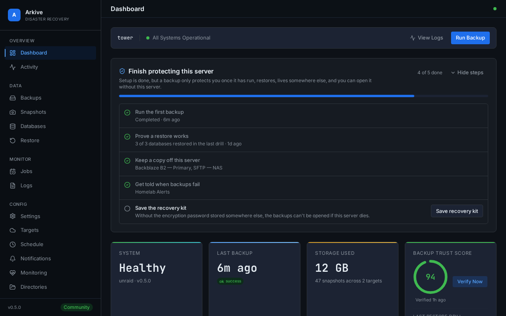

# Arkive user guide

Arkive backs up the Docker apps on an Unraid server. It finds the databases behind your containers, dumps each one with its own tool, and stores the dumps, your Unraid flash configuration and the folders you choose as encrypted [restic](https://restic.net/) snapshots on storage you control. After that it keeps checking that backups are still happening and that the dumps actually restore.

## Where to start

| If you want to | Read |
|----------------|------|
| Install Arkive on Unraid | [Quick start on Unraid](quick-start.md) |
| Understand each step of first-time setup | [Setup wizard](setup-wizard.md) |
| Know what is left before the server counts as protected | [Finish protecting this server](setup-checklist.md) |
| Choose and configure where backups go | [Storage providers](storage-providers.md) |
| Get alerts when something goes wrong | [Notifications](notifications.md) and [Overdue backups and heartbeat](monitoring.md) |
| Make sure you can recover if the server dies | [Recovery kit](recovery-kit.md) |
| Get files or a database back | [Restoring backups](restore.md), including the [guided database restore](restore.md#restore-one-database-guided) |
| Prove the database dumps restore | [Restore drills](restore-drills.md) |
| See each database's last dump, size trend and last drill | [Database health](monitoring.md#database-health-and-shrinking-dumps) |
| Find out why a run is `partial` or a job is overdue | [Troubleshooting](troubleshooting.md) |
| Move to a newer version | [Upgrading](upgrading.md) |
| Decide how to expose Arkive on your network | [Security and deployment model](security.md) |

## What a backup run does

Each backup job runs the same pipeline:

1. **Discover.** For jobs that dump databases, Arkive lists your containers through the Docker socket and finds their databases: PostgreSQL, MariaDB/MySQL, MongoDB, SQLite and Redis.
2. **Dump.** Each database is dumped with its native tool into `/config/dumps` (Full Backup and Database Dumps jobs). A dump much smaller than that database's recent dumps makes the run `partial` (see [Database health](monitoring.md#database-health-and-shrinking-dumps)).
3. **Archive the flash drive.** On Unraid, `/boot/config` is archived into the same folder as `flash_<timestamp>.tar` (Full Backup and Flash Drive jobs).
4. **Snapshot.** restic backs up the dump folder and every enabled watched directory to each storage target of the job. A copy of Arkive's own database (`arkive_self.db`) goes into the dump folder first, so it is in every snapshot too.
5. **Apply retention.** `restic forget` applies your keep-daily, keep-weekly and keep-monthly settings on each target. The space is reclaimed by a prune that runs every Sunday at 04:00.
6. **Report.** The run ends as `success`, `partial` (something was missed, with the reason) or `failed`, and a notification goes to the channels that subscribed to that outcome.

Because every job uploads the same set of paths, every snapshot is a complete restore point. A `partial` run usually still wrote a snapshot, but not always: a job with no storage target to upload to ends as `partial` with "nothing was uploaded" and leaves no restore point at all.

## Words used in this guide

- **Job**: a scheduled backup. There are three types. *Full Backup* refreshes the database dumps and the flash archive, *Database Dumps* refreshes only the dumps, and *Flash Drive* refreshes only the flash archive. All three then upload a complete snapshot.
- **Target**: a storage destination (a local folder, SFTP server, B2, S3-compatible bucket, Wasabi, Dropbox or Google Drive). Each target holds its own restic repository.
- **Snapshot**: one restic backup in a target's repository.
- **Run status**: `success`, `partial`, `failed`, `skipped` (a scheduled run that could not start because another backup or restore was still running after 3 hours) or `cancelled`.

## Try the interface with demo data

Add `?demo=true` to any Arkive page, for example `http://your-server:8200/?demo=true`. The web interface then uses sample data built into the frontend (containers, databases, snapshots, restore drills, the setup checklist) instead of your server's API, so you can look around without signing in. Nothing you do in demo mode changes your configuration. Reload the page without the parameter to leave demo mode.

The screenshots in this guide and in the README were taken in demo mode. `frontend/scripts/docs-screenshots.sh` takes them again after an interface change.
