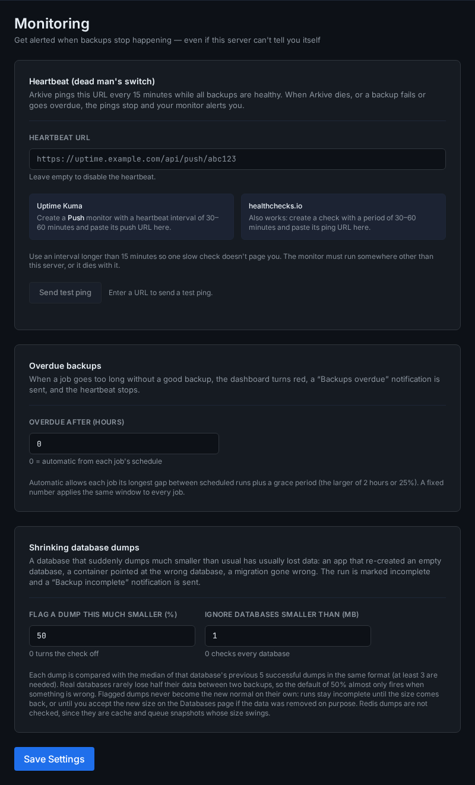

# Overdue backups and heartbeat

A run that fails sends a notification. That doesn't help when runs stop happening at all (the container is down, the scheduler stopped) or when runs "complete" without backing up what they exist for. Arkive covers those cases in two ways:

- The **freshness watchdog** checks every 15 minutes that each job has produced a good backup recently enough.
- The **heartbeat** pings an outside monitor while everything is healthy, so that monitor alerts you when the pings stop, including when Arkive itself is down.

Both are configured under **Settings → Monitoring**, together with the [shrinking-dump check](#database-health-and-shrinking-dumps).

## When a job counts as overdue

A job is overdue when its last good run started longer ago than its window:

- **Automatic window (the default):** the longest gap between two scheduled runs of the job, plus the larger of 2 hours or 25% of that gap.
- **Fixed window:** set **Overdue after (hours)** to a number from 1 to 8760, and every job gets that window. `0` means automatic.

Examples of the automatic window:

| Schedule | Longest gap | Window |
|----------|-------------|--------|
| `0 * * * *` (hourly) | 1 h | 3 h |
| `0 6,18 * * *` (06:00 and 18:00) | 12 h | 15 h |
| `0 7 * * *` (daily) | 24 h | 30 h |
| `0 2 * * 1-5` (weekdays) | 72 h (Friday to Monday) | 90 h |
| `0 7 * * 0` (weekly) | 168 h | 210 h |

A job that has never had a good run is measured from when it was created. Paused jobs are not checked.

### What counts as a good run

- a run with status `success`, or
- a `partial` run that still wrote a snapshot to at least one target and, for a job that dumps databases, dumped at least one database. The database condition is waived when discovery worked, found no databases, and the job has never dumped one.

So a run that uploaded a snapshot but missed one directory keeps the job fresh, and you hear about the miss through the `backup.partial` notification. A `partial` database run that dumped nothing doesn't count.

## What happens when a job is overdue

- The dashboard shows a red "A backup job is overdue" alert that links to the job, and `GET /api/status` reports `status: "error"` with the job under `backup_freshness.stale_jobs`.
- The Activity feed records it.
- A **Backups overdue** (`backup.stale`) notification is sent, and repeated every 24 hours while the job stays overdue.
- The heartbeat stops.

When the job produces a good backup again, the Activity feed records "*job* is producing good backups again".

## Heartbeat

The heartbeat is a dead man's switch: Arkive requests a URL every 15 minutes, and an outside monitor alerts you when the requests stop.

### Set it up

1. Create the check in your monitor. It must run somewhere other than this server, or it goes down with it.
    - **Uptime Kuma:** add a *Push* monitor with a heartbeat interval of 30 to 60 minutes, and copy its push URL.
    - **healthchecks.io:** create a check with a period of 30 to 60 minutes, and copy its ping URL.
2. Paste the URL into **Settings → Monitoring → Heartbeat URL** and click **Save Settings**.
3. Click **Send test ping** and confirm that the monitor received it.

Use an interval longer than 15 minutes so that one slow check doesn't page you.

### When the ping is sent

Every 15 minutes, Arkive sends an HTTP `GET` to the URL (10-second timeout, following redirects, user agent `Arkive heartbeat`). A 2xx response counts as delivered. The ping is sent only while all of these hold:

- at least one job is enabled,
- no job is overdue, and
- no job's latest finished run is bad: `failed`, or `partial` without meeting the good-run rule above.

Otherwise the ping is withheld and the log says "Heartbeat withheld: backups need attention". Your monitor then alerts after its interval. If Arkive, its scheduler or the whole server stops, the pings stop too.

**Send test ping** always sends, whatever the state of the backups, so you can check the URL. The URL must start with `http://` or `https://`. Leave the field empty to turn the heartbeat off.

## No offsite copy

A backup kept only on the server it protects is lost with that server: a dead disk controller, a fire, theft, ransomware. Arkive looks at the storage targets your enabled jobs actually upload to and warns on the dashboard when every one of them is on this server:

- a local folder, unless it is a network share (NFS, SMB, sshfs, an rclone mount);
- an SFTP or S3 target whose host points back at this server: `localhost`, the server's own name or addresses, or a container running on it, such as a MinIO container.

An offsite target that no enabled job uploads to does not count; the warning tells you when you have one. Add it to a job, or leave the job's target list empty so it uploads to every enabled target.

This is a warning, not an error. It does not change the system status, the overdue-backup check or the heartbeat. The [setup checklist](setup-checklist.md#3-keep-a-copy-off-this-server) has a simpler offsite step of its own, which only asks whether an enabled non-local target exists, so the two can disagree. Channels subscribed to **No offsite copy** (`backup.no_offsite`) are notified. When Arkive can't tell where a target is, for example because DNS is down, it keeps its last answer.

## Database health and shrinking dumps

The **Databases** page shows the state of each database on its own: when it was last dumped successfully, how large that dump was and how the size has moved, the point in time it can be restored to, the result of its last restore drill, and what is wrong if something is.

Arkive also compares each new dump with that database's recent ones. A dump at least 50% smaller than the median of the previous five successful dumps is flagged, the run becomes `partial`, and the usual `backup.partial` notification says which database shrank. That is what an app re-creating an empty database, a container pointed at the wrong database after an update, or a botched migration looks like. The small dump is still uploaded, and earlier snapshots keep the earlier one.

- A database is only judged once it has three successful dumps, and only when its usual dump is at least 1 MB.
- Redis is not checked: a cache legitimately empties.
- If the database really is smaller now, click **Accept new size** next to it on the Databases page. Until then, or until the size comes back, every run stays `partial`.
- **Settings → Monitoring** has both thresholds. Setting the percentage to 0 turns the check off.

## Other scheduled checks

The watchdog and heartbeat sit alongside these system jobs (times in the container's time zone):

| When | What |
|------|------|
| Every 5 minutes | Storage target health check. A target that becomes unreachable sends `target.error`. |
| Every 15 minutes | Freshness watchdog and heartbeat |
| Daily 02:00 | Activity entries older than 90 days are removed |
| Daily 03:00 | Container discovery |
| Sundays 04:00 | Retention prune on every enabled target (`restic forget --prune`). Holds the backup lock; scheduled backups wait for it. |
| Sundays 05:00 | Repository check (`restic check`) on every enabled target |
| Sundays 06:00 | Verification: repository check, a random file restore with a SHA-256 check, and a check of the local database dumps. Produces the trust score on the dashboard. A target that fails or scores below 50 sends `verification.failed`. |
| Sundays 07:00 (default) | [Restore drill](restore-drills.md) |
