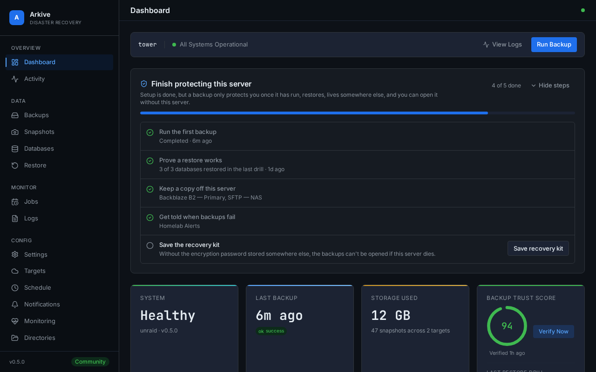

# Quick start on Unraid

This page gets Arkive running on an Unraid server and producing its first good backup. It takes about fifteen minutes plus the time of the first upload.

## 1. Install the container

Install Arkive from Community Applications if it is listed there. Otherwise add the template by hand from the Unraid terminal:

```bash
wget -O /boot/config/plugins/dockerMan/templates-user/my-Arkive.xml \
  https://raw.githubusercontent.com/islamdiaa/Arkive/main/unraid-template.xml
```

Then open the **Docker** tab, choose **Add Container** and pick **Arkive** from the template list.

The template sets up these mappings:

| Setting | Container path | Default host path | Mode | Why |
|---------|----------------|-------------------|------|-----|
| Web UI Port | `8200` | `8200` | tcp | The web interface and API |
| Config Directory | `/config` | `/mnt/user/appdata/arkive` | read-write | Arkive's database, keyfile, logs, dumps and restores |
| Docker Socket | `/var/run/docker.sock` | `/var/run/docker.sock` | read-only | Container discovery and database dumps |
| App Data | `/mnt/user/appdata` | `/mnt/user/appdata` | read-only | The app data to back up |
| Flash Drive | `/boot-config` | `/boot/config` | read-only | Unraid flash configuration backup |
| Local Backups | `/mnt/user/backups` | `/mnt/user/backups` | read-write | Destination for a local storage target |
| Restic Cache | `/cache` | `/mnt/user/appdata/arkive/cache` | read-write | restic metadata cache (safe to delete) |
| Timezone | `TZ` | `America/New_York` | variable | Time zone used by the schedules |

Before you click **Apply**:

- **Keep `--user 0:0` in Extra Parameters.** The template runs Arkive as root because the flash configuration and some app-owned SQLite files are only readable by root. Without it Arkive logs a warning at startup, and flash backups and some SQLite dumps fail, which makes runs `partial`.
- **Set `TZ` to your time zone.** Job schedules fire in the container's time zone.
- **Map every other share you want backed up.** The template only maps `/mnt/user/appdata`. To protect another share, such as `/mnt/user/documents`, add a path mapping with the same path on both sides and access mode read-only. Arkive can only back up paths it can see inside the container.
- **Leave the Local Backups mapping in place if you plan to use a local target.** A local target must be a host path mapped into the container. Arkive refuses a path inside the container's own filesystem, because those files disappear when the container is re-created (for example on every update).

Arkive refuses to start without the Docker socket. The container log then says `Docker socket required. Mount with -v /var/run/docker.sock:/var/run/docker.sock:ro`.

Keep port 8200 on your LAN. Arkive controls Docker on the host, so treat it like an admin console: see [Security and deployment model](security.md).

## 2. Run the setup wizard

Open `http://<your-server>:8200`. A fresh install opens the setup wizard, which asks for an encryption password, scans your containers, sets up a storage target and the schedules, and lets you choose directories. [Setup wizard](setup-wizard.md) explains each step.

Finish the wizard right after installing. Until it has run, anyone who can reach port 8200 could complete it and take over the instance.

At the end, the wizard shows your **API key** once. Save it in your password manager. You need it to sign in from another browser and for the API and CLI. A copy is also written to `/config/.api_key` (on the host: `/mnt/user/appdata/arkive/.api_key`).

## 3. After setup

The dashboard opens with a **Finish protecting this server** checklist. Work through it before you rely on Arkive. Each step ticks itself off once Arkive has seen it done, and [Finish protecting this server](setup-checklist.md) explains exactly what completes each one.



1. **Run the first backup.** **Run first backup now** in the checklist, or **Run Backup** at the top of the dashboard, starts the Full Backup job. You can also choose any job under **Backups → Backup Now**. Watch the run on the **Backups** page. It should end as `success`; a `partial` run doesn't complete the step. If it ends as `partial`, the run lists what was missed. See [Troubleshooting](troubleshooting.md).
2. **Prove a restore works.** Once the first backup has completed, **Run restore test now** runs a restore drill, which loads recent database dumps into throwaway containers. See [Restore drills](restore-drills.md).
3. **Keep a copy off this server.** A local target on the same array protects against mistakes and corruption, not against losing the server. Add a cloud or SFTP target. See [Storage providers](storage-providers.md).
4. **Add a notification channel** (Settings → Notifications) so failures and overdue backups reach you. See [Notifications](notifications.md).
5. **Save the recovery kit** (Settings → Recovery Kit). It holds the encryption password and the location of every repository. Without the password no snapshot can be opened, and the copy inside Arkive is lost with the server. See [Recovery kit](recovery-kit.md).

One more thing the checklist doesn't track: **set a heartbeat URL** (Settings → Monitoring) so an outside monitor alerts you when Arkive itself stops. See [Overdue backups and heartbeat](monitoring.md).

## Other Docker hosts

Arkive is built for Unraid but runs on any Docker host. The [README](https://github.com/islamdiaa/Arkive#quick-start) has a Docker Compose file and a `docker run` command with the same mappings. On a host without an Unraid flash drive, Arkive skips the flash backup instead of failing it.
