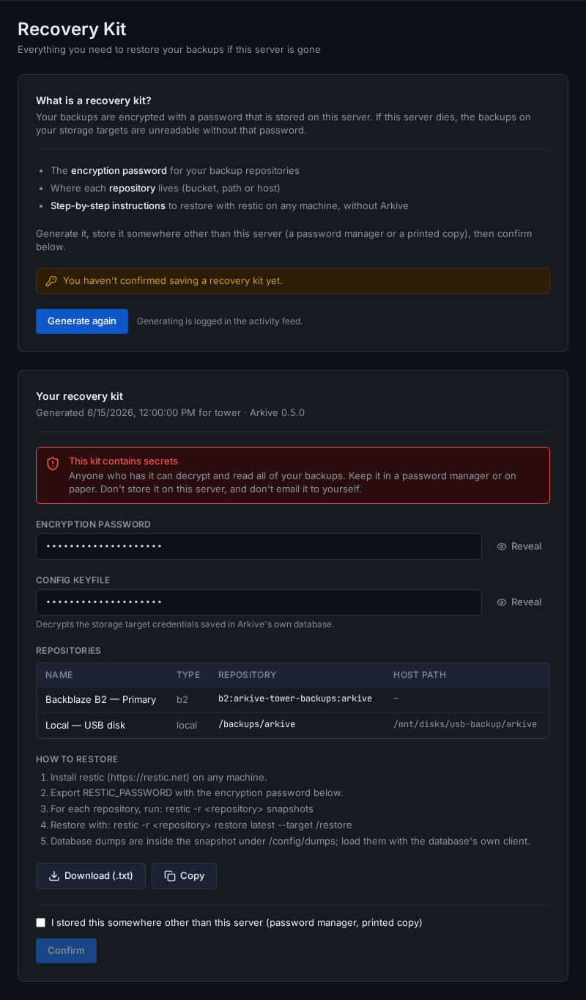

# Recovery kit

Your backups are encrypted with the password you chose in the setup wizard. Arkive keeps that password in its database, encrypted with `/config/.keyfile`, and both live on the server they protect. If that server dies and the password isn't stored anywhere else, every snapshot is unreadable.

The recovery kit is a one-page export with everything needed to open the backups from another machine.

## What's in it

- **The encryption password** (restic's repository password).
- **Every repository**: name, type, whether it is enabled, the restic repository string, and the non-secret settings such as bucket, endpoint, region, host, username and path. For a local target it also shows the folder's path on the host, where Arkive can work it out.
- **Restore instructions**, with and without Arkive.
- **The config keyfile** (`/config/.keyfile`). It decrypts the credentials stored in Arkive's own database, and you only need it to bring back Arkive's settings (see [Restoring backups](restore.md#bring-back-arkives-own-settings)).
- The server name, the date it was generated, and the Arkive version.

Storage provider credentials (keys, secrets, passwords, tokens) are **not** in the kit. Keep those in your provider account or your password manager.

## Save it

1. Go to **Settings → Recovery Kit** and click **Generate recovery kit**. Each generation is recorded in the Activity feed.
2. Use **Reveal** to check the values, then **Download (.txt)** or **Copy**.
3. Store it somewhere other than this server: a password manager, or a printed copy kept safely.
4. Tick **I stored this somewhere other than this server** and click **Confirm**.

Until you confirm, `GET /api/status` reports `recovery_kit_confirmed: false` and the dashboard reminds you: as the *Save the recovery kit* step of the [setup checklist](setup-checklist.md#5-save-the-recovery-kit) while that checklist is open, otherwise as a separate "Save your recovery kit" reminder.

**Anyone who has the kit can decrypt and read all of your backups.** Don't store it on the server it protects, and don't e-mail it to yourself.

## Keep it current

The encryption password can't change after setup, but the repository list can. Generate the kit again and replace your stored copy after you add, remove or re-create a storage target. The repository string of a cloud or SFTP target contains its target ID, which is new every time a target is added.

## Using it

[Restoring backups](restore.md#disaster-recovery-on-a-fresh-server) walks through recovering a lost server with the kit, both with a fresh Arkive install and with restic alone.
