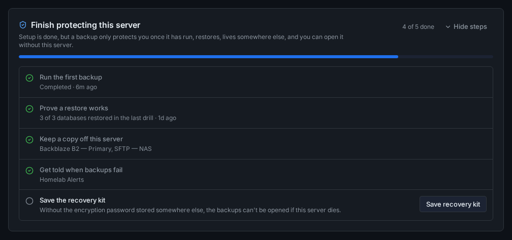

# Finish protecting this server

The setup wizard creates the backup jobs and, if you gave it one, a storage target. That doesn't make the server safe yet. Nothing has run, nothing has been restored, the only copy may sit on the server itself, nobody hears about failures, and the encryption password may exist only inside Arkive.

So after setup the dashboard shows a **Finish protecting this server** card with five steps. Each step is judged from what Arkive has recorded: backup runs, restore drills and verifications, storage targets, notification channels and the recovery kit confirmation. Opening a settings page from the card doesn't tick a step off. Doing the thing does.

## Reading the card

The header shows how many steps are done ("4 of 5 done") and a progress bar. Each step has one of four states:

- **Done** (green tick): the step's detail says what satisfied it, such as the target names, and when.
- **To do** (empty circle): with a short reason when there is one, such as "Only local targets are configured".
- **In progress** (spinner): a backup, restore drill or restore test is running now.
- **Needs attention** (warning icon): the last attempt went wrong, for example a failed backup or a failed drill. The reason is shown in the step.

**Hide steps** collapses the card to its header. The choice is remembered in this browser only.

Steps that are not done have an action:

| Step | Action in the card |
|------|--------------------|
| Run the first backup | **Run first backup now** starts the same job as **Run Backup** at the top of the dashboard. |
| Prove a restore works | **Run restore test now** starts a restore drill, or a restore test when there is nothing to drill (see below). It becomes available once the first backup has completed, and is disabled while a backup is running. |
| Keep a copy off this server | **Add offsite target** opens Settings → Storage Targets. |
| Get told when backups fail | **Add notification channel** opens Settings → Notifications. |
| Save the recovery kit | **Save recovery kit** opens Settings → Recovery Kit. |

The card refreshes on its own when a drill or restore test finishes.

## The five steps

### 1. Run the first backup

**Done when** a backup run of any job has finished with status `success`.

A `partial` run doesn't count, even one that wrote a snapshot. The [overdue-backup check](monitoring.md#what-counts-as-a-good-run) accepts some `partial` runs, because a run that missed one folder still keeps you covered from day to day. This step is about whether the server is protected, and a `partial` run may be missing a database or a folder.

If there is no clean run yet, the step says why:

- a run is going: *In progress*;
- the latest run was `failed` or `partial`: *Needs attention*, with the run's message. [A run ends as `partial`](troubleshooting.md#a-run-ends-as-partial) explains the messages;
- there are no backup jobs: "No backup jobs are configured."

### 2. Prove a restore works

How a restore is proven depends on whether this server has a database that a [restore drill](restore-drills.md) can test. Drills test PostgreSQL, MariaDB, MySQL and SQLite. They don't test MongoDB or Redis.

**With a database a drill can test** (one that Arkive has dumped successfully, or one that discovery found and you haven't excluded), the step is **done when** the latest drill that passed or failed **passed**. The detail reads, for example, "3 of 3 databases restored in the last drill". Drills that were skipped don't count either way. If the latest decisive drill failed, the step needs attention and shows the drill's error. [If a drill fails](restore-drills.md#if-a-drill-fails) explains what to look at.

**Without one** (no databases at all, only MongoDB or Redis, or testable databases that are excluded and were never dumped), a drill could never pass. A restore test counts instead: the step is **done when** the latest [verification](monitoring.md#other-scheduled-checks) passed after restoring a file. Verification restores a random file from the latest snapshot and checks its SHA-256 checksum; a verification that restored no file doesn't count. If the latest verification failed, the step needs attention.

The restore test also counts when there are testable databases but the last drill found no dump it could test, for example because every dump was larger than the drill's *Max dump size* setting. The step then says "The last drill found nothing it can test", with the reason.

**Run restore test now** starts a drill in the first case and a verification in the second. A verification can't start within 10 minutes of the previous one. Both also run on their own every week: drills on the drill schedule (Sundays at 07:00 by default) and verification on Sundays at 06:00.

### 3. Keep a copy off this server

**Done when** at least one enabled storage target is not a local path: SFTP, Backblaze B2, S3-compatible, Wasabi, Dropbox or Google Drive. See [Storage providers](storage-providers.md).

A local target never counts, even when its path is a network share mounted on the host. Arkive can't tell such a path apart from a disk in this server, and this step only says "done" when it is sure.

When the step is not done, it lists what it found: "Only local targets are configured: ..." or, when an offsite target exists but is disabled, "Disabled: ...".

This step only looks at which targets exist. The dashboard's separate [No offsite copy](monitoring.md#no-offsite-copy) warning looks further: it follows the targets your enabled jobs actually upload to, and it notices an SFTP or S3 target whose host is this server, such as a MinIO container. It also doesn't count a local path on a network share as being on this server. So the two can disagree: the step can be done while the warning is showing, and the other way round. Act on the warning when you see it.

### 4. Get told when backups fail

**Done when** at least one notification channel is enabled. When every channel is paused, the step says "Disabled: ..." with their names.

The step doesn't check which events a channel subscribes to or whether its URL works. Click **Test** on the channel to make sure messages arrive. See [Notifications](notifications.md).

### 5. Save the recovery kit

**Done when** you have confirmed saving a recovery kit after the current encryption password was set: on Settings → Recovery Kit, generate the kit, store it somewhere other than this server, tick **I stored this somewhere other than this server** and click **Confirm**. Generating the kit without confirming doesn't count. See [Recovery kit](recovery-kit.md).

If the encryption password was set after your last confirmation, the step needs attention: "The encryption password changed after the last kit was saved; save a new one."

## Dismissing the card

When all five steps are done, the card's title changes to **This server is protected** and a **Dismiss** button appears. Until then the card can only be collapsed, not dismissed: the API (`POST /api/setup-checklist/dismiss`) refuses to dismiss an unfinished checklist.

Dismissing is stored on the server, so the card disappears in every browser. The Activity feed records "Setup checklist completed: this server is protected".

A dismissed card doesn't come back. Problems after that have their own signals: the [overdue-backup alert](monitoring.md#what-happens-when-a-job-is-overdue), failed-drill and failed-backup [notifications](notifications.md#events), the No offsite copy warning and the recovery kit reminder on the dashboard.

The dismissal belongs to this server. A settings export (`GET /api/settings/export`) leaves it out, so a configuration imported onto a rebuilt server shows that server's checklist from the start.

The checklist is also available as JSON from `GET /api/setup-checklist`.
